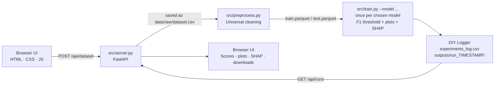
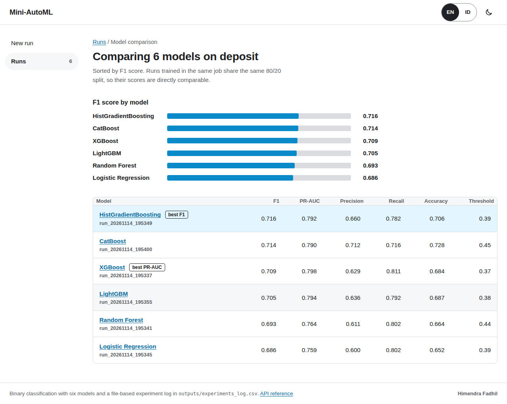

# Mini-MLaaS Platform: Universal AutoML Web App with DIY Experiment Tracker


---

## Project Overview

**Mini-MLaaS** is a Dockerized, end-to-end *Machine Learning as a Service* platform. Upload **any binary-classification CSV** through a lightweight web UI (FastAPI backend, plain HTML/CSS/JavaScript frontend), pick the column to predict and a model (or all six at once), and the platform runs a two-stage pipeline: universal data cleaning, then imbalance-aware training with an F1-optimised decision threshold and SHAP explanations. Choosing "compare all models" trains XGBoost, Random Forest, Logistic Regression, HistGradientBoosting, LightGBM and CatBoost on the same split and ranks them side by side.

Instead of using MLflow or another tracking server, the project includes a **custom experiment logger written from scratch with standard Python file I/O**. Every run is recorded, reproducible and inspectable with nothing more than a CSV reader. The project combines **software engineering** (modular CLI stages, process isolation, containerisation, no extra dependencies for tracking) with **machine learning** (class-imbalance handling, threshold optimisation, explainability).

---

## Key Features

- **Universal AutoML.** Accepts any binary-classification CSV and cleans it automatically:
  - drops ID-like columns (every value unique), constant columns, empty columns and very high-cardinality text columns
  - neutralises the `" "` *space trap* in every text column (for example, IBM Telco's `TotalCharges`) and casts numeric-looking text to float
  - imputes missing values (median for numeric, mode for categorical) and one-hot encodes categoricals
  - encodes the target to `1/0`, recognising `Yes/No`, `True/False` and `1/0` labels and otherwise treating the minority class as positive
  - drops any feature that almost exactly matches the target (numeric correlation ≥ 0.98, or text categories that determine the target) as a guard against data leakage
  - auto-detects the separator (`,` `;` tab `|`) and the encoding (UTF-8 or Latin-1)
- **Six models, one comparison.** Pick one model or train all six on the same split:

  | Model | Library | Class imbalance | SHAP explainer | Saved as |
  |---|---|---|---|---|
  | XGBoost | `xgboost` | `scale_pos_weight` | Tree | `xgboost_model.json` |
  | Random Forest | `scikit-learn` | `class_weight="balanced"` | Tree | `random_forest_model.joblib` |
  | Logistic Regression | `scikit-learn` (with `StandardScaler`) | `class_weight="balanced"` | Linear | `logistic_regression_model.joblib` |
  | HistGradientBoosting | `scikit-learn` | `class_weight="balanced"` | Permutation (sampled, up to 300 rows) | `hist_gradient_boosting_model.joblib` |
  | LightGBM | `lightgbm` | `scale_pos_weight` | Tree | `lightgbm_model.txt` |
  | CatBoost | `catboost` | `scale_pos_weight` | Tree | `catboost_model.cbm` |

  - all models share the same `max_depth`, `learning_rate` and `n_estimators` wherever they have an equivalent, so the comparison is fair
  - the comparison page ranks the models by F1, marks the best F1 and best PR-AUC, and links to each run; any runs can also be compared later by ticking them on the **Runs** page
- **Zero-Dependency DIY Tracker.** A custom logger built only on `csv`, `json` and `pathlib`:
  - appends every run's model, hyperparameters and metrics to a central `outputs/experiments_log.csv`
  - saves the evaluation plots, SHAP plot, model file and full metrics (`run_metrics.json`) in a timestamped folder: `outputs/run_YYYYMMDD_HHMMSS/`
- **Dynamic ML Optimization.**
  - calculates `scale_pos_weight = #negatives / #positives` from the training data (or uses balanced class weights for the scikit-learn models)
  - sweeps decision thresholds from **0.1 to 0.9** on `predict_proba()` output and keeps the one with the **highest F1-Score**
  - reports F1, Precision, Recall, PR-AUC and Accuracy
  - saves a confusion matrix, ROC curve and precision-recall curve, each marking the chosen threshold
- **Explainable AI (XAI).** Generates a SHAP summary plot for every run, so you can see which features drive the model's predictions.
- **Web UI without a UI framework.** FastAPI serves a JSON API and a plain HTML/CSS/JavaScript frontend:
  - a column explorer that profiles every column (type, distinct values, missing values, mini distribution) and only lets you pick columns with exactly two classes as the target
  - an **Exclude columns** checklist for leakage the pipeline cannot detect on its own (columns only known after the outcome); excluded columns are recorded with every run (`preprocess.py --exclude=<column>` on the command line)
  - training runs as a background job with live per-step progress and logs
  - a run page with scores, evaluation plots, SHAP, the F1-by-threshold curve and file downloads
  - light and dark themes, keyboard navigation and a mobile layout
- **Containerized.** Ships as a single Docker Compose service with a healthcheck, ready to run with one command.

---

## What Can It Predict?

The pipeline is universal for one kind of problem: **binary classification on tabular data**. Any question that can be phrased as

> *Will this [customer / patient / transaction / machine ...] [do X / have Y]? Yes or no.*

and answered from information known **before** the outcome happens can be trained without changing any code. Telco churn and Bank Marketing in the notebook are two examples from different domains.

| Domain | Example question | Public dataset (target column) |
|---|---|---|
| Business & marketing | Will the customer cancel the subscription? | IBM Telco Customer Churn (`Churn Label`) |
| | Will the client open a term deposit after the call? | Bank Marketing (`deposit` / `y`) |
| | Will the guest cancel the hotel booking? | Hotel Booking Demand (`is_canceled`) |
| Finance | Will the borrower default? | Default of Credit Card Clients, German Credit |
| | Is this transaction fraudulent? | Credit Card Fraud (`Class`) |
| | Will the loan be approved? | Loan Prediction (`Loan_Status`) |
| Healthcare | Does the patient have diabetes? | Pima Indians Diabetes (`Outcome`) |
| | Is the tumour malignant? | Breast Cancer Wisconsin (`diagnosis`) |
| | Is there heart disease / a stroke risk? | Heart Disease (`target`), Stroke Prediction (`stroke`) |
| HR & education | Will the employee leave? | IBM HR Attrition (`Attrition`) |
| | Will the student drop out or graduate on time? | student performance / dropout datasets |
| Industry | Will the machine fail? | AI4I Predictive Maintenance (`Machine failure`) |
| Other | Will it rain tomorrow? | Rain in Australia (`RainTomorrow`) |
| | Is the water safe to drink? | Water Potability (`Potability`) |
| | Is the website a phishing site? | Phishing Websites (`Result`) |

### Targets that are not yes/no yet

A numeric or multi-class target can still be used after turning it into a yes/no question before uploading, for example:

- wine quality 0 to 10: *is the quality good (7 or higher)?*
- house price: *is the price above the median?*
- exam score: *did the student pass (60 or higher)?*
- match result win/draw/loss: *did the home team win?*

The original column must then be removed or excluded, because it contains the answer.

### Not supported (yet)

- **Regression**, predicting a number directly (a price, next month's sales).
- **Multi-class targets**, choosing one of three or more classes at once. The pipeline stops with a clear message.
- **Non-tabular data**: images, audio, free text, or several tables that first need to be joined.
- **Time series forecasting**: the split is random, not by time, so future rows could leak into training.

### Works, but needs care

- **Date and long free-text columns** are dropped automatically as high-cardinality text. Derive useful parts first (for example month and weekday from a date).
- **Very small datasets** (a few dozen rows) give unstable scores, and a class with fewer than 2 rows stops the stratified split.
- **Leakage that only domain knowledge can reveal** (a column recorded after the outcome, such as `duration` in Bank Marketing) is not caught automatically. Tick it under **Exclude columns** before training.

---

## System Architecture / Data Flow



1. **Upload:** the browser sends the file to `POST /api/dataset`; `src/server.py` saves it to `data/raw/dataset.csv` and returns a profile of every column, used to pick the target.
2. **Stage 1, Preprocess:** `src/preprocess.py --target <col>` validates, cleans and encodes the data, then writes a stratified 80/20 split to Parquet.
3. **Stage 2, Train:** `src/train.py --target <col> --model <name>` trains the chosen model, optimises the threshold and generates the evaluation plots and the SHAP plot. In comparison mode the server runs this stage once per model, all on the same split.
4. **Log:** the DIY logger creates `outputs/run_TIMESTAMP/` and appends a row to `outputs/experiments_log.csv` for every model.
5. **Display:** the UI polls the job, then opens the new run page (one model) or the comparison page (several models), which read the log and run folders through `GET /api/runs/<run_id>`.

> The server runs each stage with `subprocess.run` in a background thread, so the web layer stays fully decoupled from the ML code. Each stage is also a standalone CLI tool with `argparse`. Only one training job runs at a time.

### API

| Method | Endpoint | Purpose |
|---|---|---|
| `GET` | `/api/health` | Liveness probe (used by the Docker healthcheck) |
| `GET` | `/api/dataset` | Profile of the current dataset (404 if none) |
| `POST` | `/api/dataset` | Upload a CSV (multipart `file`) and profile its columns |
| `GET` | `/api/models` | The models that can be trained (key, label, default) |
| `POST` | `/api/jobs` | Start the pipeline: `{"target": "<column>", "models": ["xgboost", ...], "exclude": ["<column>", ...]}` (`models` defaults to `["xgboost"]`, several models = comparison; `exclude` lists columns to leave out, default none) |
| `GET` | `/api/jobs/current` | The job that is running right now, or `null` |
| `GET` | `/api/jobs/{job_id}` | Job status, per-step logs and the resulting run ids |
| `GET` | `/api/runs` | Every row of `experiments_log.csv`, newest first |
| `GET` | `/api/runs/{run_id}` | One run: metrics, threshold curve, available files |
| `GET` | `/api/runs/{run_id}/files/{name}` | A plot, the model or `run_metrics.json` (`?download=true` to save) |
| `GET` | `/api/experiments_log.csv` | The raw experiment log |

Interactive API docs (Swagger UI) are served at `/api/docs`.

---

## Folder Structure

```text
.
├── data/
│   ├── raw/                      # Telco_customer_churn.csv, bank.csv (notebook datasets);
│   │                             #   dataset.csv + dataset_info.json = last upload in the web UI
│   ├── processed/                # train.parquet, test.parquet, metadata.json (web UI pipeline)
│   └── clean/                    # telco_churn_clean.csv, bank_marketing_clean.csv (written by the notebook)
├── docs/screenshots/             # Images used in this README
├── models/
│   ├── telco/                    # 6 trained models + metadata.json (written by the notebook);
│   └── bank/                     #   accuracy_mode/ in each holds the best model tuned for accuracy
├── notebook.ipynb                # Analysis report for both datasets: audit, leakage, EDA, 6 models, SHAP
├── src/
│   ├── server.py                 # FastAPI: JSON API, background jobs, static files
│   ├── static/                   # Frontend: index.html, style.css, app.js (vanilla JS)
│   ├── preprocess.py             # Stage 1: universal validation & preprocessing
│   ├── models.py                 # Model registry: how to build, save and explain each model
│   └── train.py                  # Stage 2: model training + DIY experiment logger
├── outputs/
│   ├── experiments_log.csv       # Central log of every run
│   └── run_YYYYMMDD_HHMMSS/
│       ├── confusion_matrix.png  # Confusion matrix at the chosen threshold
│       ├── roc_curve.png         # ROC curve with the operating point
│       ├── pr_curve.png          # Precision-recall curve with the operating point
│       ├── shap_summary.png      # SHAP summary plot
│       ├── <model>_model.<ext>   # Trained model (format depends on the model, see the table above)
│       └── run_metrics.json      # Full metrics + threshold/F1 curve
├── Dockerfile
├── docker-compose.yml
└── requirements.txt
```

---

## Quick Start (How to Run)

### Option A: Docker (recommended)

```bash
git clone https://github.com/himendrafadh/Dockerized-ML-Training-Pipeline.git
cd Dockerized-ML-Training-Pipeline
docker compose up --build
```

Then open the web UI at **http://localhost:8501**

1. On **New run**, upload a binary-classification `.csv`.
2. In the column explorer, pick the column to predict (only columns with exactly two values can be selected).
   Optionally open **Exclude columns** and tick any column the model must not learn from, for example `duration` in the Bank Marketing data, which is only known after the call has ended.
3. Under **Choose the model**, pick one model or **Compare all models**.
4. Click the train button, follow the progress, then review the run page or the comparison. All runs are listed under **Runs**, where you can tick any two or more to compare them.

### Option B: Local Python environment

```bash
python -m venv .venv && source .venv/bin/activate
pip install -r requirements.txt
uvicorn server:app --app-dir src --port 8501
```

You can also run each stage directly from the command line:

```bash
python src/preprocess.py --target Churn --input data/raw/dataset.csv
python src/train.py --target Churn --model catboost --max-depth 5 --learning-rate 0.05 --n-estimators 150
```

`--model` accepts `xgboost` (default), `random_forest`, `logistic_regression`, `hist_gradient_boosting`, `lightgbm` and `catboost`.

### Option C: The analysis notebook

`notebook.ipynb` analyses two datasets with the same code as the app (`src/preprocess.py`, `src/models.py`): **Part A, Telco Customer Churn** (7,043 rows, 26.5% positive) and **Part B, Bank Marketing** (`data/raw/bank.csv`, 11,162 rows, 47.4% positive). Shared steps are written once as functions, so both datasets are treated identically:

1. data-quality audit (blank cells, constant and ID columns, disguised missing values such as `unknown`, sentinels such as `pdays = -1`)
2. leakage check: the same model trained with and without the suspect columns
3. exploratory data analysis
4. cleaning, then a stratified 80/20 split
5. a majority-class baseline
6. all six models with 5-fold cross-validation; the decision threshold is chosen on out-of-fold predictions, so the test score stays unbiased
7. evaluation curves and SHAP for the best model
8. accuracy mode vs business mode
9. saving the models to `models/<dataset>/` and the cleaned datasets to `data/clean/`

**Part C** compares the two datasets and closes with the overall conclusions.

```bash
pip install -r requirements-notebook.txt
jupyter lab notebook.ipynb
```

**Telco** results on the 1,409-customer test set (business mode, best model: CatBoost):

| Model | Accuracy | F1 | ROC-AUC |
|---|---|---|---|
| CatBoost | 0.777 | 0.640 | 0.860 |
| Logistic Regression | 0.776 | 0.629 | 0.848 |
| HistGradientBoosting | 0.768 | 0.629 | 0.850 |
| Random Forest | 0.767 | 0.621 | 0.848 |
| LightGBM | 0.762 | 0.629 | 0.850 |
| XGBoost | 0.750 | 0.631 | 0.851 |
| Baseline (always "No") | 0.735 | 0.000 | 0.500 |

These scores use the **business mode** (class weights + F1-tuned threshold), which catches 279 of the 374 churners in the test set. The notebook also reports an **accuracy mode** (no class weights, threshold tuned for accuracy): every model lands between 0.801 and 0.811 accuracy, the best by cross-validation being Logistic Regression at 0.803, but it catches only 201 churners. About 0.81 is the honest ceiling for this dataset; the notebook shows that keeping the leakage columns pushes accuracy to 0.988, which is why scores of 85% and above on Telco churn should be treated with suspicion.

**Bank Marketing** results (`duration` excluded: the length of the sales call is only known after the call has ended):

| | Best model | Accuracy | F1 | ROC-AUC |
|---|---|---|---|---|
| Business mode | LightGBM | 0.687 | 0.705 | 0.795 |
| Accuracy mode | HistGradientBoosting | 0.737 | 0.683 | 0.797 |
| Baseline (always "no") | | 0.526 | 0.000 | 0.500 |
| With `duration` (leakage, not valid) | CatBoost | 0.856 | | 0.928 |

Raw accuracy cannot be compared across the two datasets: Telco starts from a 0.735 baseline and Bank from 0.526. Measured as the gain over the baseline, the Bank model learns more (+21.1 points in accuracy mode, against +6.9 for Telco).

### Running on a remote machine (SSH)

The UI listens on the remote machine, so `localhost:8501` in your laptop's browser will not reach it. Forward the port from your laptop:

```bash
ssh -L 8501:localhost:8501 <user>@<remote-host>
```

Keep that session open and browse to **http://localhost:8501** on your laptop.

### Troubleshooting

- **Files in `outputs/` or `data/` owned by root:** the container writes to the mounted folders as root. Add `user: "1000:1000"` (your UID:GID) to the service in `docker-compose.yml`, or fix ownership with `sudo chown -R $USER: outputs data`.
- **"Target must have exactly 2 classes":** pick a column with exactly two distinct values; the column explorer only enables those.
- **"Each class needs at least 2 samples":** the rarer class is too small for a stratified 80/20 split. Use more data or another target.

---

## Experiment Log Format

`outputs/experiments_log.csv` gets one new row per run. Example from the IBM Telco churn dataset (target `Churn Label`, leakage columns `Churn Score`, `Churn Reason` and `CLTV` removed before upload):

| Timestamp | Target_Column | Model | Max_Depth | Learning_Rate | N_Estimators | Scale_Pos_Weight | Best_Threshold | F1_Score | Precision | Recall | PR_AUC |
|---|---|---|---|---|---|---|---|---|---|---|---|
| run_20261110_203046 | Churn Label | XGBoost | 5 | 0.05 | 150 | 2.768562 | 0.54 | 0.634146 | 0.541667 | 0.764706 | 0.661896 |
| run_20261110_203052 | Churn Label | Logistic Regression | | | | | 0.61 | 0.631953 | 0.566879 | 0.713904 | 0.640272 |
| run_20261110_203103 | Churn Label | CatBoost | 5 | 0.05 | 150 | 2.768562 | 0.54 | 0.64918 | 0.548983 | 0.794118 | 0.674606 |

- Hyperparameter cells are left empty when the model has no such setting (Logistic Regression uses none of them; the scikit-learn models use balanced class weights instead of `Scale_Pos_Weight`).
- Logs written before the `Model` column existed are upgraded automatically on the next run: the column is added and the old rows are marked `XGBoost`, the only model at the time.
- Accuracy, class labels, the hyperparameters actually used and the full F1-by-threshold sweep are stored per run in `run_metrics.json`.

---

## Screenshots

### Web UI: Column Explorer & Target Selection


### Web UI: Run Page


### Explainability Tab (SHAP)


### Model Comparison


> Screenshots taken from a run on the IBM Telco churn dataset described above.

---

## Tech Stack

| Layer | Tools |
|---|---|
| Backend | FastAPI, Uvicorn |
| Frontend | HTML, CSS, vanilla JavaScript (no framework, no build step) |
| ML / Data | XGBoost, LightGBM, CatBoost, scikit-learn, Pandas, NumPy, PyArrow |
| Explainability | SHAP, Matplotlib |
| Experiment Tracking | Custom DIY logger (Python `csv` / `json` / `pathlib`) |
| Deployment | Docker, Docker Compose |

---

## Engineering Notes

- **Why no MLflow?** Building the tracker by hand shows the core ideas behind experiment tracking (run IDs, saved artifacts, a log you only ever add to) without depending on a separate tracking server.
- **Leakage awareness:** the pipeline drops features that almost exactly match the target, but columns derived from the outcome (for example, a vendor-provided "churn score") should still be removed before upload. If F1 looks too good (above about 0.95), check the top feature in the SHAP tab first.
- **Why a plain JavaScript frontend?** No framework and no build step: FastAPI serves three static files, so the whole UI is readable in one sitting and the container needs nothing beyond Python.
- **Job state is in memory.** Restarting the server forgets running jobs, but every finished run is safe on disk in `outputs/`.
- **One registry for all models.** `src/models.py` describes each model once (builder, saver, SHAP explainer, which shared settings apply). Adding a model means adding one entry there plus its description in the UI.
- **Model file formats.** XGBoost, LightGBM and CatBoost are saved in their own data formats. The scikit-learn models are saved with `joblib`, which is pickle-based: only load `.joblib` files you created yourself or trust.
- **Comparison mode stops at the first failure.** Models trained before the failure stay in the log and are offered for comparison on the job page.
