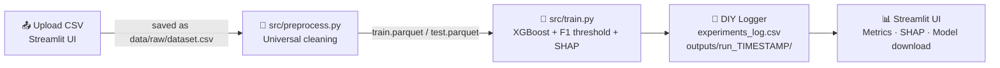

# 🤖 Mini-MLaaS Platform: Universal AutoML Web App with DIY Experiment Tracker


---

## 📌 Project Overview

**Mini-MLaaS** is a Dockerized, end-to-end *Machine Learning as a Service* platform. Upload **any binary-classification CSV** through a Streamlit web UI, pick the column to predict, and the platform runs a two-stage pipeline: universal data cleaning, then imbalance-aware XGBoost training with an F1-optimised decision threshold and SHAP explanations.

Instead of using MLflow or another tracking server, the project includes a **custom experiment logger written from scratch with standard Python file I/O**. Every run is recorded, reproducible and inspectable with nothing more than a CSV reader. The project combines **software engineering** (modular CLI stages, process isolation, containerisation, no extra dependencies for tracking) with **machine learning** (class-imbalance handling, threshold optimisation, explainability).

---

## ✨ Key Features

- 🌐 **Universal AutoML.** Accepts any binary-classification CSV and cleans it automatically:
  - drops ID-like columns (every value unique), constant columns, empty columns and very high-cardinality text columns
  - neutralises the `" "` *space trap* in every text column (for example, IBM Telco's `TotalCharges`) and casts numeric-looking text to float
  - imputes missing values (median for numeric, mode for categorical) and one-hot encodes categoricals
  - encodes the target to `1/0`, recognising `Yes/No`, `True/False` and `1/0` labels and otherwise treating the minority class as positive
  - drops any feature that almost exactly matches the target (correlation ≥ 0.98) as a guard against data leakage
- 📒 **Zero-Dependency DIY Tracker.** A custom logger built only on `csv`, `json` and `pathlib`:
  - appends every run's hyperparameters and metrics to a central `outputs/experiments_log.csv`
  - saves the SHAP plot, model binary (`xgboost_model.json`) and full metrics (`run_metrics.json`) in a timestamped folder: `outputs/run_YYYYMMDD_HHMMSS/`
- ⚖️ **Dynamic ML Optimization.**
  - calculates `scale_pos_weight = #negatives / #positives` from the training data
  - sweeps decision thresholds from **0.1 to 0.9** on `predict_proba()` output and keeps the one with the **highest F1-Score**
  - reports F1, Precision, Recall and PR-AUC
- 🔍 **Explainable AI (XAI).** Generates a SHAP summary plot for every run, so you can see which features drive the model's predictions.
- 🐳 **Containerized UI.** The Streamlit frontend ships as a single Docker Compose service with a healthcheck, ready to run with one command.

---

## 🏗️ System Architecture / Data Flow



1. **Upload:** `src/app.py` saves the uploaded file to `data/raw/dataset.csv` and asks for the target column.
2. **Stage 1, Preprocess:** `src/preprocess.py --target <col>` validates, cleans and encodes the data, then writes a stratified 80/20 split to Parquet.
3. **Stage 2, Train:** `src/train.py --target <col>` trains XGBoost, optimises the threshold and generates the SHAP plot.
4. **Log:** the DIY logger creates `outputs/run_TIMESTAMP/` and appends a row to `outputs/experiments_log.csv`.
5. **Display:** the UI reads the latest log row and run folder, then shows the metrics, the SHAP plot and the full experiment history.

> The UI calls each stage with `subprocess.run`, so the web layer stays fully decoupled from the ML code. Each stage is also a standalone CLI tool with `argparse`.

---

## 📁 Folder Structure

```text
.
├── data/
│   ├── raw/                      # Uploaded dataset (dataset.csv)
│   └── processed/                # train.parquet, test.parquet, metadata.json
├── src/
│   ├── app.py                    # Streamlit web interface
│   ├── preprocess.py             # Stage 1: universal validation & preprocessing
│   └── train.py                  # Stage 2: XGBoost training + DIY experiment logger
├── outputs/
│   ├── experiments_log.csv       # Central log of every run
│   └── run_YYYYMMDD_HHMMSS/
│       ├── shap_summary.png      # SHAP summary plot
│       ├── xgboost_model.json    # Trained model binary
│       └── run_metrics.json      # Full metrics + threshold/F1 curve
├── Dockerfile
├── docker-compose.yml
└── requirements.txt
```

---

## 🚀 Quick Start (How to Run)

### 🐳 Option A: Docker (recommended)

```bash
git clone https://github.com/himendrafadh/Dockerized-ML-Training-Pipeline.git
cd Dockerized-ML-Training-Pipeline
docker compose up --build
```

Then open the web UI at **👉 http://localhost:8501**

1. Upload a binary-classification `.csv`.
2. Choose a column under **"Select the Target Column to Predict"**.
3. Click **Run Pipeline** and review the metrics, SHAP plot and experiment history.

### 🐍 Option B: Local Python environment

```bash
python -m venv .venv && source .venv/bin/activate
pip install -r requirements.txt
streamlit run src/app.py
```

You can also run each stage directly from the command line:

```bash
python src/preprocess.py --target Churn
python src/train.py --target Churn --max-depth 5 --learning-rate 0.05 --n-estimators 150
```

---

## 📒 Experiment Log Format

`outputs/experiments_log.csv` gets one new row per run:

| Timestamp | Target_Column | Max_Depth | Learning_Rate | N_Estimators | Scale_Pos_Weight | Best_Threshold | F1_Score | Precision | Recall | PR_AUC |
|---|---|---|---|---|---|---|---|---|---|---|
| run_20261108_153022 | Churn | 5 | 0.05 | 150 | 2.77 | 0.53 | … | … | … | … |

---

## 🖼️ Screenshots

### Web UI: Upload & Target Selection


### Web UI: Results Dashboard


### SHAP Summary Plot


> 📝 *Replace the placeholder images above with your own screenshots in `docs/screenshots/`.*

---

## 🧰 Tech Stack

| Layer | Tools |
|---|---|
| Frontend | Streamlit |
| ML / Data | XGBoost, scikit-learn, Pandas, NumPy, PyArrow |
| Explainability | SHAP, Matplotlib |
| Experiment Tracking | Custom DIY logger (Python `csv` / `json` / `pathlib`) |
| Deployment | Docker, Docker Compose |

---

## 💡 Engineering Notes

- **Why no MLflow?** Building the tracker by hand shows the core ideas behind experiment tracking (run IDs, saved artifacts, a log you only ever add to) without depending on a separate tracking server.
- **Leakage awareness:** the pipeline drops features that almost exactly match the target, but columns derived from the outcome (for example, a vendor-provided "churn score") should still be removed before upload.
