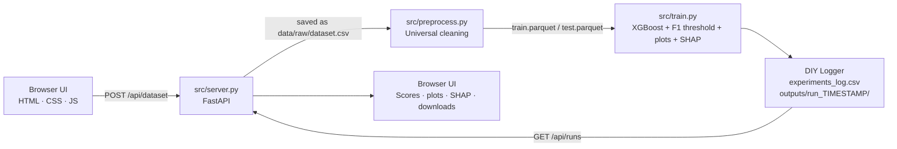
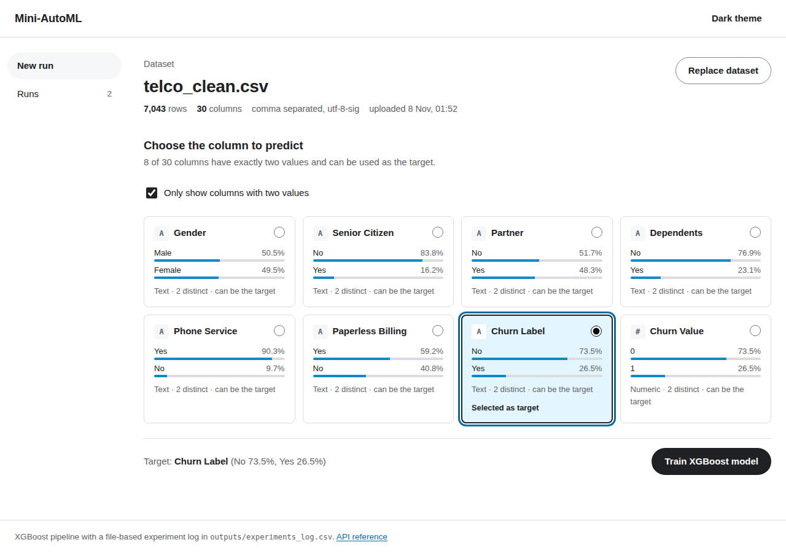
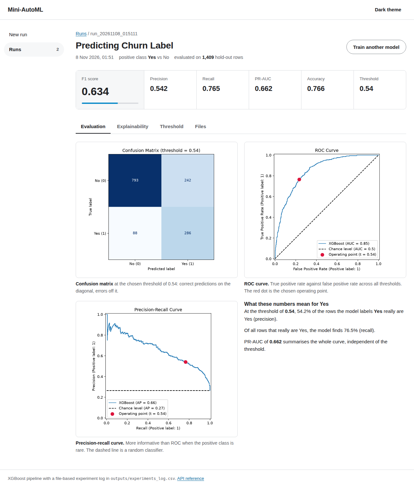
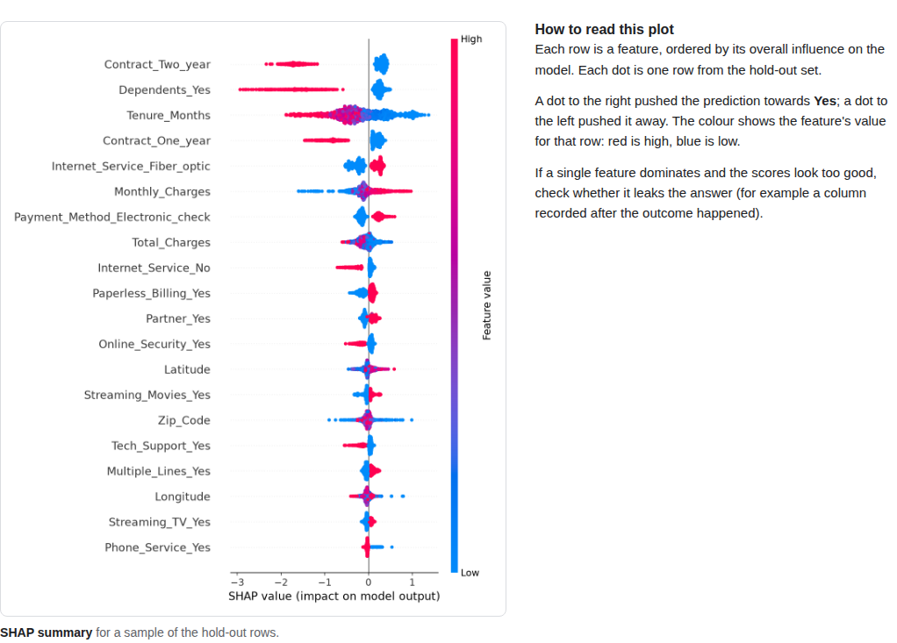

# Mini-MLaaS Platform: Universal AutoML Web App with DIY Experiment Tracker


---

## Project Overview

**Mini-MLaaS** is a Dockerized, end-to-end *Machine Learning as a Service* platform. Upload **any binary-classification CSV** through a lightweight web UI (FastAPI backend, plain HTML/CSS/JavaScript frontend), pick the column to predict, and the platform runs a two-stage pipeline: universal data cleaning, then imbalance-aware XGBoost training with an F1-optimised decision threshold and SHAP explanations.

Instead of using MLflow or another tracking server, the project includes a **custom experiment logger written from scratch with standard Python file I/O**. Every run is recorded, reproducible and inspectable with nothing more than a CSV reader. The project combines **software engineering** (modular CLI stages, process isolation, containerisation, no extra dependencies for tracking) with **machine learning** (class-imbalance handling, threshold optimisation, explainability).

---

## Key Features

- **Universal AutoML.** Accepts any binary-classification CSV and cleans it automatically:
  - drops ID-like columns (every value unique), constant columns, empty columns and very high-cardinality text columns
  - neutralises the `" "` *space trap* in every text column (for example, IBM Telco's `TotalCharges`) and casts numeric-looking text to float
  - imputes missing values (median for numeric, mode for categorical) and one-hot encodes categoricals
  - encodes the target to `1/0`, recognising `Yes/No`, `True/False` and `1/0` labels and otherwise treating the minority class as positive
  - drops any feature that almost exactly matches the target (numeric correlation ≥ 0.98, or text categories that determine the target) as a guard against data leakage
  - auto-detects the separator (`,` `;` tab `|`) and the encoding (UTF-8 or Latin-1)
- **Zero-Dependency DIY Tracker.** A custom logger built only on `csv`, `json` and `pathlib`:
  - appends every run's hyperparameters and metrics to a central `outputs/experiments_log.csv`
  - saves the evaluation plots, SHAP plot, model binary (`xgboost_model.json`) and full metrics (`run_metrics.json`) in a timestamped folder: `outputs/run_YYYYMMDD_HHMMSS/`
- **Dynamic ML Optimization.**
  - calculates `scale_pos_weight = #negatives / #positives` from the training data
  - sweeps decision thresholds from **0.1 to 0.9** on `predict_proba()` output and keeps the one with the **highest F1-Score**
  - reports F1, Precision, Recall, PR-AUC and Accuracy
  - saves a confusion matrix, ROC curve and precision-recall curve, each marking the chosen threshold
- **Explainable AI (XAI).** Generates a SHAP summary plot for every run, so you can see which features drive the model's predictions.
- **Web UI without a UI framework.** FastAPI serves a JSON API and a plain HTML/CSS/JavaScript frontend:
  - a column explorer that profiles every column (type, distinct values, missing values, mini distribution) and only lets you pick columns with exactly two classes as the target
  - training runs as a background job with live per-step progress and logs
  - a run page with scores, evaluation plots, SHAP, the F1-by-threshold curve and file downloads
  - light and dark themes, keyboard navigation and a mobile layout
- **Containerized.** Ships as a single Docker Compose service with a healthcheck, ready to run with one command.

---

## System Architecture / Data Flow



1. **Upload:** the browser sends the file to `POST /api/dataset`; `src/server.py` saves it to `data/raw/dataset.csv` and returns a profile of every column, used to pick the target.
2. **Stage 1, Preprocess:** `src/preprocess.py --target <col>` validates, cleans and encodes the data, then writes a stratified 80/20 split to Parquet.
3. **Stage 2, Train:** `src/train.py --target <col>` trains XGBoost, optimises the threshold and generates the evaluation plots and the SHAP plot.
4. **Log:** the DIY logger creates `outputs/run_TIMESTAMP/` and appends a row to `outputs/experiments_log.csv`.
5. **Display:** the UI polls the job, then opens the new run page, which reads the log row and run folder through `GET /api/runs/<run_id>`.

> The server runs each stage with `subprocess.run` in a background thread, so the web layer stays fully decoupled from the ML code. Each stage is also a standalone CLI tool with `argparse`. Only one training job runs at a time.

### API

| Method | Endpoint | Purpose |
|---|---|---|
| `GET` | `/api/health` | Liveness probe (used by the Docker healthcheck) |
| `GET` | `/api/dataset` | Profile of the current dataset (404 if none) |
| `POST` | `/api/dataset` | Upload a CSV (multipart `file`) and profile its columns |
| `POST` | `/api/jobs` | Start the pipeline: `{"target": "<column>"}` |
| `GET` | `/api/jobs/current` | The job that is running right now, or `null` |
| `GET` | `/api/jobs/{job_id}` | Job status, per-step logs and the resulting run id |
| `GET` | `/api/runs` | Every row of `experiments_log.csv`, newest first |
| `GET` | `/api/runs/{run_id}` | One run: metrics, threshold curve, available files |
| `GET` | `/api/runs/{run_id}/files/{name}` | A plot, the model or `run_metrics.json` (`?download=true` to save) |
| `GET` | `/api/experiments_log.csv` | The raw experiment log |

Interactive API docs (Swagger UI) are served at `/api/docs`.

---

## Folder Structure

```text
.
├── data/
│   ├── raw/                      # Uploaded dataset.csv + dataset_info.json (column profile)
│   └── processed/                # train.parquet, test.parquet, metadata.json
├── docs/screenshots/             # Images used in this README
├── src/
│   ├── server.py                 # FastAPI: JSON API, background jobs, static files
│   ├── static/                   # Frontend: index.html, style.css, app.js (vanilla JS)
│   ├── preprocess.py             # Stage 1: universal validation & preprocessing
│   └── train.py                  # Stage 2: XGBoost training + DIY experiment logger
├── outputs/
│   ├── experiments_log.csv       # Central log of every run
│   └── run_YYYYMMDD_HHMMSS/
│       ├── confusion_matrix.png  # Confusion matrix at the chosen threshold
│       ├── roc_curve.png         # ROC curve with the operating point
│       ├── pr_curve.png          # Precision-recall curve with the operating point
│       ├── shap_summary.png      # SHAP summary plot
│       ├── xgboost_model.json    # Trained model binary
│       └── run_metrics.json      # Full metrics + threshold/F1 curve
├── Dockerfile
├── docker-compose.yml
└── requirements.txt
```

---

## Quick Start (How to Run)

### Option A: Docker (recommended)

```bash
git clone https://github.com/himendrafadh/Dockerized-ML-Training-Pipeline.git
cd Dockerized-ML-Training-Pipeline
docker compose up --build
```

Then open the web UI at **http://localhost:8501**

1. On **New run**, upload a binary-classification `.csv`.
2. In the column explorer, pick the column to predict (only columns with exactly two values can be selected).
3. Click **Train XGBoost model**, follow the progress, then review the run page. All runs are listed under **Runs**.

### Option B: Local Python environment

```bash
python -m venv .venv && source .venv/bin/activate
pip install -r requirements.txt
uvicorn server:app --app-dir src --port 8501
```

You can also run each stage directly from the command line:

```bash
python src/preprocess.py --target Churn --input data/raw/dataset.csv
python src/train.py --target Churn --max-depth 5 --learning-rate 0.05 --n-estimators 150
```

### Running on a remote machine (SSH)

The UI listens on the remote machine, so `localhost:8501` in your laptop's browser will not reach it. Forward the port from your laptop:

```bash
ssh -L 8501:localhost:8501 <user>@<remote-host>
```

Keep that session open and browse to **http://localhost:8501** on your laptop.

### Troubleshooting

- **Files in `outputs/` or `data/` owned by root:** the container writes to the mounted folders as root. Add `user: "1000:1000"` (your UID:GID) to the service in `docker-compose.yml`, or fix ownership with `sudo chown -R $USER: outputs data`.
- **"Target must have exactly 2 classes":** pick a column with exactly two distinct values; the column explorer only enables those.
- **"Each class needs at least 2 samples":** the rarer class is too small for a stratified 80/20 split. Use more data or another target.

---

## Experiment Log Format

`outputs/experiments_log.csv` gets one new row per run. Example from the IBM Telco churn dataset (target `Churn Label`, leakage columns `Churn Score`, `Churn Reason` and `CLTV` removed before upload):

| Timestamp | Target_Column | Max_Depth | Learning_Rate | N_Estimators | Scale_Pos_Weight | Best_Threshold | F1_Score | Precision | Recall | PR_AUC |
|---|---|---|---|---|---|---|---|---|---|---|
| run_20261108_015111 | Churn Label | 5 | 0.05 | 150 | 2.768562 | 0.54 | 0.634146 | 0.541667 | 0.764706 | 0.661896 |

Accuracy, class labels and the full F1-by-threshold sweep are stored per run in `run_metrics.json`, so the CSV header stays stable.

---

## Screenshots

### Web UI: Column Explorer & Target Selection


### Web UI: Run Page


### Explainability Tab (SHAP)


> Screenshots taken from a run on the IBM Telco churn dataset described above.

---

## Tech Stack

| Layer | Tools |
|---|---|
| Backend | FastAPI, Uvicorn |
| Frontend | HTML, CSS, vanilla JavaScript (no framework, no build step) |
| ML / Data | XGBoost, scikit-learn, Pandas, NumPy, PyArrow |
| Explainability | SHAP, Matplotlib |
| Experiment Tracking | Custom DIY logger (Python `csv` / `json` / `pathlib`) |
| Deployment | Docker, Docker Compose |

---

## Engineering Notes

- **Why no MLflow?** Building the tracker by hand shows the core ideas behind experiment tracking (run IDs, saved artifacts, a log you only ever add to) without depending on a separate tracking server.
- **Leakage awareness:** the pipeline drops features that almost exactly match the target, but columns derived from the outcome (for example, a vendor-provided "churn score") should still be removed before upload. If F1 looks too good (above about 0.95), check the top feature in the SHAP tab first.
- **Why a plain JavaScript frontend?** No framework and no build step: FastAPI serves three static files, so the whole UI is readable in one sitting and the container needs nothing beyond Python.
- **Job state is in memory.** Restarting the server forgets running jobs, but every finished run is safe on disk in `outputs/`.
